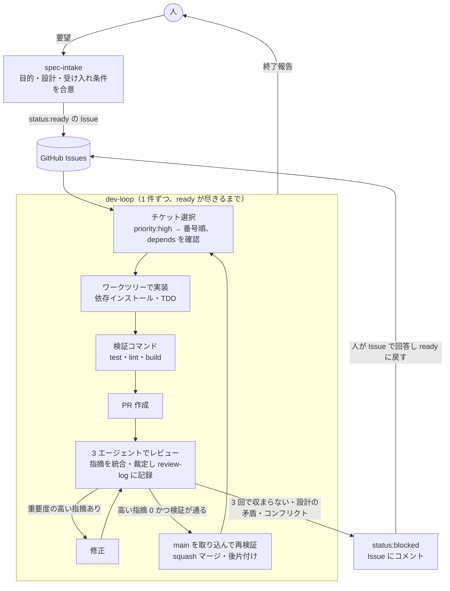
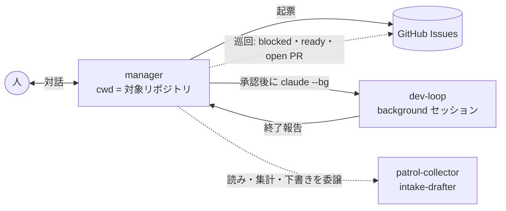

# dev-team

[](https://github.com/nesheep5/dev-team/actions/workflows/ci.yml)

要件を人と詰めて GitHub Issue にし、`status:ready` の Issue を 1 件ずつ「ワークツリーで実装 → PR → 3 つのレビューエージェントによる反復レビュー → squash マージ」まで連続で処理する Claude Code プラグイン。ready の Issue が尽きるまで人の操作なしで回り、解決できないものは `status:blocked` にして Issue のコメントで人に判断を返す。リポジトリごとの窓口セッション（manager）と、複数リポジトリの進行を 1 画面に出すダッシュボードを含む。

```
/plugin install dev-team --marketplace nesheep5/dev-team
```

## 何をするか

Issue を唯一の受け渡し口にして、要件の整理と実装を別のセッションに分ける。

- **要件 → Issue**: 要望を受けたら、目的・設計・受け入れ条件を人と 1 つずつ合意してから Issue を作る。Issue 本文は「目的 / 設計 / 受け入れ条件 / 補足」の 4 節で、実装側はこの本文だけを読んで作業する
- **Issue → マージ**: `status:ready` の Issue を優先度と依存（`depends: #N`）の順に選び、ワークツリーで TDD で実装し、プロジェクトのテスト・lint・build を通し、PR を作る。PR は 3 つのレビューエージェントに並列で読ませ、重要度の高い指摘が無くなるまで最大 3 回直す。通れば `main` を取り込み直して検証し、squash マージする
- **後片付け**: ループはスリープやネットワーク切断で途中で終わることがある。起動時と終了前に、前回の残骸（途中のチケット、孤児の開発サーバー、孤児のワークツリー）を記録ファイルでなくシステムの状態から見つけて回収する
- **記録**: レビュー指摘は採否にかかわらず全件 `review-log.jsonl` に、手順書（SKILL.md）の不備はループ自身が気づいた時点で `friction-log.jsonl` に追記し、リポジトリにコミットして残す

## 全体の流れ



manager を使うと、人はリポジトリごとの manager セッションとだけ話す。manager は要望を spec-intake の手順で Issue にし、承認を得てから dev-loop を background セッション（`claude --bg`）で起動し、終了報告をセッション間メッセージで受け取って中継する。



## スキルとエージェント

| 名前 | 起動 | 役割 |
|---|---|---|
| spec-intake | `/dev-team:spec-intake`、または「こういう機能が欲しい」などの要望 | 要件のヒアリング → 設計の合意 → 受け入れ条件の合意 → Issue 作成。1 PR に収まらなければ依存順に分割する |
| dev-loop | `/dev-team:dev-loop`、または「ready を上から実装して」など | `status:ready` の Issue を全件、実装からマージまで処理し、最後に 1 つの報告にまとめる |
| manager | `/dev-team:manager` | リポジトリごとの窓口。話題の振り分け、起票、dev-loop の起動と監視、巡回、改善提案 |
| dev-loop-dashboard | `/dev-team:dev-loop-dashboard` | ブラウザの監視盤。チケットごとの工程・担当エージェント・依存の DAG を、複数リポジトリぶん縦に並べて出す。Node 標準ライブラリだけで動く |
| patrol-collector（エージェント） | manager が起動 | 巡回の情報収集と、manager-log の集計。`Bash, Read` だけを持つ |
| intake-drafter（エージェント） | manager が起動 | 起票前のリポジトリの読解と、Issue 本文の下書き |

dev-loop のレビューは [pr-review-toolkit](https://github.com/anthropics/claude-plugins-official/tree/main/plugins/pr-review-toolkit)（公式マーケットプレイス claude-plugins-official）の code-reviewer / pr-test-analyzer / silent-failure-hunter を使う。入っていなければ、汎用のエージェントにバグ検出・テスト網羅・エラーハンドリングの 3 観点を割り当てて代える。

## 使い方

### 必要なもの

- Claude Code。manager を使うなら、background セッション（`claude --bg` / `claude agents --json` / `claude attach`）とセッション間メッセージが使える版
- `git`、認証済みの `gh`（対象は GitHub のリポジトリだけ）
- Node.js 18 以上（ダッシュボード）、Python 3（manager と停止スクリプトのテストが使う）
- macOS か Linux（開発サーバーの停止に `lsof` / `ps` / `pgrep` を使う）
- 推奨: pr-review-toolkit プラグイン
- 任意: [Herdr](https://herdr.dev)（manager がその中で動いていれば、dev-loop の attach 用タブを自分の隣に足す。無くても動く）

### インストール

Claude Code 2.1.275 以降なら、セッションの中で次の 1 行を実行する。

```
/plugin install dev-team --marketplace nesheep5/dev-team
```

それより前の版では、2 段階で入れる。

```
/plugin marketplace add nesheep5/dev-team
/plugin install dev-team@dev-team
```

### 設定

どれも任意。`settings.json` の `env` などで渡す。

| 環境変数 | 既定 | 用途 |
|---|---|---|
| `DEV_TEAM_HOME` | `~/.claude/dev-team` | 状態ファイルの置き場。manager-log、起票の下書き、Herdr の記録、ダッシュボードの台帳 `projects.json` |
| `DEV_TEAM_FLOW_REPO` | なし | 開発フロー・スキル・ルール・設定を管理しているリポジトリのローカルの絶対パス。manager はフロー改善の話題をこのリポジトリに起票する。未設定なら、どこで直すかを人に聞く |

dev-loop を background で回すときは、経路上のコマンド（git・gh・パッケージマネージャ・検証コマンド・ワークツリー内のファイル操作）に Ask ルールが残っていないこと。background セッションは許可プロンプトに答える人がいないので、そこで止まる。開発サーバーの停止は同梱のスクリプト（`<プラグインのパス>/skills/dev-loop/scripts/stop-dev-server.sh`）の呼び出しだけを許可すればよく、生の `kill` を許可する必要は無い（ダッシュボードの停止は人が `kill <PID>` で行う）。manager は起動時に `settings.json` の Ask / deny ルールを読み、dev-loop を止めうるものを挙げる。

### 起動

要望を Issue にする。

```
/dev-team:spec-intake ログイン画面にパスワードの表示切り替えを付けたい
```

ready の Issue をまとめて処理する。対話中に「溜まっている Issue を進めて」のように頼んで dev-loop が選ばれたときは、ready の件数と先頭のタイトルを示し、開始してよいかを聞いてから始める。

```
/dev-team:dev-loop
```

manager を窓口にする。対象リポジトリのメインのワークツリーで起動する。

```
/dev-team:manager
```

ダッシュボードを開く。台帳（`<DEV_TEAM_HOME>/projects.json`）があれば全プロジェクト、無ければカレントディレクトリのリポジトリを出す。`--demo` は同梱のフィクスチャで表示し、`gh` を呼ばない。

```
/dev-team:dev-loop-dashboard
node <プラグインのパス>/skills/dev-loop-dashboard/server.mjs --demo --open
```

台帳の形は次のとおり。

```json
{ "projects": [
  { "name": "web-app", "path": "/path/to/web-app" },
  { "name": "api-server", "path": "/path/to/api-server" }
]}
```

## 設計上の判断

設計判断は ADR に残している（[docs/adr/](plugins/dev-team/docs/adr/README.md)、14 本）。ADR のステータスは決定の有効性で、実装の有無は一覧の「実装」列に分けて書いている。現在どう動くかの仕様は [docs/spec/](plugins/dev-team/docs/spec/README.md)、未実装の部分の着手順は [ROADMAP](plugins/dev-team/docs/ROADMAP.md) にある。

主な判断は次のとおり。

- **Issue を工程間の唯一の受け渡し口にする**: spec-intake と dev-loop は会話の文脈を共有しない。Issue 本文に無いことは実装されない前提で、受け入れ条件を検証可能な文で書かせる
- **起動時の回収を記録ファイルに頼らない**: 記録された PID は再起動で別のプロセスに再利用されうる。開発サーバーは「LISTEN しているプロセスの cwd が `.claude/worktrees/` の下にあるか」で、ワークツリーは「`git worktree list` に無いディレクトリか」で孤児を見つける
- **自然言語からの起動には関門を置く**（ADR 0009）: ループは ready の全件を自動マージまで進めるので、誤起動の代償が大きい。明示起動と、回答者のいない実行（サブエージェント・`claude -p`）では確認しない
- **manager はリポジトリごとに 1 つ、作業は委譲する**（ADR 0010・0011・0013）: cwd を対象リポジトリにして、そのリポジトリの CLAUDE.md を読み込んだ状態で動く。窓口の応答性を保つため、時間のかかる収集・読解・下書きはサブエージェントに出す。巡回のエージェントには書き込み系のツールを持たせない
- **ダッシュボードは 1 プロセスで全プロジェクトを縦に並べる**（ADR 0012）: タブ切り替えにすると、開いていないプロジェクトで止まったループに気づけない。`gh` の失敗や遅延はプロジェクト単位で劣化表示にとどめ、他を止めない
- **記録は揮発と累積に分ける**（ADR 0008）: 進行状況（`events.jsonl`）は gitignore し、レビュー指摘と手順の不備の記録（`.claude/dev-team-log/`）は追記のみでコミットする
- **端末ごとに違う値は環境変数で受け取る**（ADR 0014）

### 人の確認を挟む位置

| 位置 | 人がすること |
|---|---|
| Issue を作る前 | 目的・設計・受け入れ条件を、それぞれ合意する（spec-intake） |
| dev-loop の起動 | 明示的に起動する。自然言語で選ばれたときは件数を見て許可する。manager は起動を提案するだけで、起動は承認後。ローカルの `main` に未 push のコミットがあれば、件数を示して push するかを聞き、人が承知の上と答えない限り起動しない |
| blocked の Issue | Issue のコメントで判断を返し、`status:ready` に戻す |
| 改善提案 | manager が根拠の記録を添えて出す提案を、承認するまで実施しない |

### 自動マージの条件

人の確認を挟まずにマージする。条件は次をすべて満たすこと。

- 3 エージェントの指摘を統合・裁定した結果、重要度の高い指摘（バグ・データ破壊・セキュリティ・受け入れ条件の未達・テストの欠落）が 0 件
- プロジェクトの検証コマンド（test・lint・build のうち存在するもの）がすべて通る
- 最新の `main` を取り込んだうえで、コンフリクトが無く、検証コマンドが再び通る
- レビューの反復が 3 回以内

満たせなければマージせず blocked にして、何を試し何が解決できないかを Issue に書く。PR・ブランチ・ワークツリーは再開用に残す。

### 安全装置として有るもの・無いもの

有るもの:

- `main` へ直接コミットせず、PR を経由する（手順書の規則。ブランチ保護はプラグインでは設定しない）
- 同時に実装するチケットは 1 件。依存先が閉じていないチケットは飛ばす
- 開発サーバーの停止は同梱のスクリプトだけで行う。スクリプトは、プロセスグループ内のどれか 1 つでも cwd がそのリポジトリの `.claude/worktrees/` の外にある、LISTEN しているプロセスが無い、シェルや claude 本体などの保護対象を含む、のいずれかなら何も止めずに終わる
- 孤児のワークツリーは「対応する Issue が closed」かつ「ビルド生成物以外のファイルが無い」ときだけ消す。片方でも怪しければ消さずに人に回す
- manager は、頼まれずに動作中のループを止めない。1 リポジトリに 2 本目のループを起動しない

無いもの:

- **人のコードレビュー**: 現行はレビューエージェントが通せばマージする。draft PR で人の Approve を待ってからマージする流れ（ADR 0002）は未実装
- **CI の結果待ち**: マージ前に通すのはローカルの検証コマンドで、GitHub 上の CI の完了は待たない
- **権限の制御**: 何を確認なしで実行できるかは、利用者の Claude Code の権限設定（allow / ask / deny、フック）に従う。プラグインはサンドボックスを用意しない
- **費用と時間の上限**: チケットの数とレビューの反復の数に比例して、モデルの呼び出しが増える。上限を設ける仕組みは無い

## 何で確かめたか

### テストと検証

| 対象 | 方法 | 結果 |
|---|---|---|
| ダッシュボード（`server.mjs` / `lib/state.mjs`） | `node --test`。偽の `gh` とフィクスチャを注入し、状態の組み立て、プロジェクト単位の劣化、台帳の読み込みとエラー、HTTP と SSE の応答を確かめる | 38 件が通る |
| 開発サーバーの停止スクリプト | 一時ディレクトリで本物の TCP サーバーを別のプロセスグループとして起動し、`--root` の内側なら止め、外側なら止めずに終了コード 2 を返すこと、引数の検査を確かめる | 12 項目が通る |
| プラグインの manifest | `claude plugin validate --strict`（Claude Code 2.1.332） | 通る |
| 公開前の検査のフック | `tests/git-hooks.test.sh`（pre-commit・pre-push を一時リポジトリで走らせる） | 19 項目が通る |

スキルの手順そのもの（モデルが SKILL.md の通りに動くか）は、自動テストでは確かめていない。

### 個人の開発プロジェクトでの運用

個人の開発プロジェクトで、ある機能の実装計画を 11 件の Issue にし、dev-loop で 2026-09-13 夜から 2026-09-14 昼にかけて処理した。数字は、そのリポジトリにコミットされた `review-log.jsonl` / `friction-log.jsonl` と GitHub の PR の記録で数えた。

- 11 件の Issue を 11 本の PR で全件マージした。blocked は 0 件。11 件のうち 1 件は、運用中にレビューの残件から起票したもの
- レビュー指摘は 164 件。重要度は high 47 / low 117、処理は fixed 112 / deferred 27 / rejected 25
- レビュアー別では、件数は code-reviewer 62・silent-failure-hunter 57・pr-test-analyzer 45 で、high に限ると silent-failure-hunter 20・pr-test-analyzer 16・code-reviewer 11。分類は test 43・error-handling 39・style 34・bug 33・spec-mismatch 15
- 全件が 2 回以上の反復を要し、3 回目まで行ったのは 4 件
- 1 件は 3 回目のレビューで軽微な指摘（データは失われず、修正は数行）が新たに出た。規則どおりなら blocked だが、マージして別の Issue に切り出した。ループはこれを手順の不備として friction-log に記録した。同じ期間の friction-log は 4 件
- この運用は 2026-09 時点の dev-loop で行った。その後の変更のうち、同梱した停止スクリプトとダッシュボードの `DEV_TEAM_HOME` は上のテストで確かめた。manager の `DEV_TEAM_FLOW_REPO` による迂回は、実際に動かしては確かめていない

## 制限

- 対象は GitHub のリポジトリと GitHub Issues だけ。Jira などのトラッカーは扱わない
- スキルの手順書は日本語で書かれている。dev-loop はコミットメッセージを日本語で書く
- 同時に処理するチケットは 1 件で、複数チケットの並列処理はしない
- 人のコードレビューと CI の結果待ちを挟まずにマージする（上の「無いもの」）
- 未実装の部分がある: 人の Approve を待つ流れ（ADR 0002）、プロダクトごとの設定の台帳（ADR 0006）、仕様と ADR を更新する spec-intake（ADR 0005）、計測と振り返り（ADR 0004）。状態は [ROADMAP](plugins/dev-team/docs/ROADMAP.md) と仕様の状態表記にある
- manager の、リポジトリごとに分けた現在の形での通しの確認（起動 → 巡回 → dev-loop の起動 → 終了報告 → 片付け）は、記録を残していない
- background の dev-loop は、経路上に Ask ルールが残っていると許可待ちで止まる
- 開発サーバーの停止は macOS と Linux の `lsof` / `ps` / `pgrep` に依存する

## 開発

### 構成

    .claude-plugin/marketplace.json       マーケットプレイスの目録（dev-team だけを載せる）
    plugins/dev-team/                     プラグイン本体
      .claude-plugin/plugin.json
      skills/
        spec-intake/SKILL.md
        dev-loop/SKILL.md
        dev-loop/scripts/stop-dev-server.sh   開発サーバーの停止スクリプト
        manager/SKILL.md
        manager/references/herdr.md       Herdr 内での表示手順
        dev-loop-dashboard/               SKILL.md・server.mjs・lib/state.mjs・index.html・demo/
      agents/                             patrol-collector.md・intake-drafter.md
      docs/
        spec/                             仕様（SSoT）。節ごとに実装済み / 未実装を書く
        adr/                              設計判断（0001〜0014）
        ROADMAP.md                        着手順と進捗
    tests/
      dev-loop-dashboard/                 ダッシュボードのテスト（node --test）
      stop-dev-server.test.sh             停止スクリプトのテスト
      validate.sh                         claude plugin validate
      git-hooks.test.sh                   git-hooks のテスト
    git-hooks/                            公開前の検査（pre-commit・pre-push）
    .github/workflows/ci.yml              push と PR で tests/ を走らせる

プラグイン本体をリポジトリのルートに置かないのは、tests・git-hooks まで利用者の環境に複製しないため。

### テスト

```bash
bash tests/validate.sh                              # claude plugin validate
node --test 'tests/dev-loop-dashboard/*.test.mjs'   # ダッシュボードのテスト
bash tests/stop-dev-server.test.sh                  # 停止スクリプトのテスト
bash tests/git-hooks.test.sh                        # git-hooks のテスト
```

### 手元での動かし方

このリポジトリのクローンをローカルのパスでマーケットプレイスとして登録し、元の場所から読み込む。

```
claude plugin marketplace add <このリポジトリのパス>
```

編集は次のセッションか `/reload-plugins` で反映される。ローカルのパスで登録したマーケットプレイスは cache に複製せず元の場所から読むため、version を上げる必要は無い。

## 公開前の検査

公開リポジトリなので、コミットと push の前に次を検査する（`git config core.hooksPath git-hooks` で有効にする）。

- gitleaks による秘匿情報の検出（pre-commit・pre-push）
- author・committer が GitHub の noreply アドレスであること（pre-push）
- push する差分の判断レビュー（pre-push がレビューの記録を確かめる）。語のリストでは守らず、差分を読んで個人・組織・非公開の情報が無いかを判断する。手順は CLAUDE.md

## ライセンス

MIT（[LICENSE](LICENSE)）
